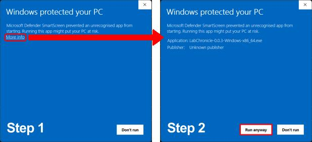
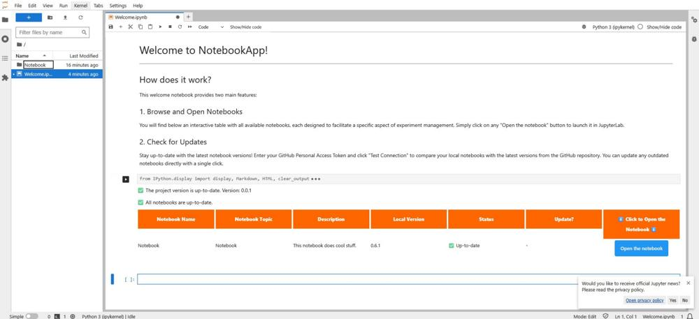
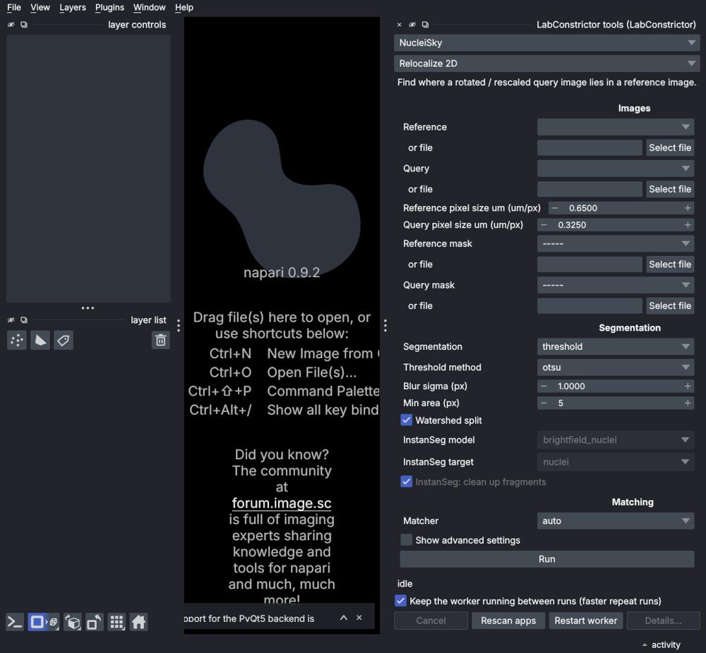

<section class="lc-pagehead"><h1>Use an app</h1>
Install an app on your computer, open it, and, if you work in napari, Fiji or QuPath, run its tools there.
</section>
<ul class="lc-features"><li class="lc-feature">

<strong>Install it</strong>Download the installer for your system. It takes a few minutes and you only do it once. Windows may warn about an unsigned installer; the guide shows the two clicks that get past it.<a href="../guides/install/">Install an app &rarr;</a>
</li><li class="lc-feature">

<strong>Open it and work</strong>The app opens in your browser with a Welcome notebook that lists its notebooks. Pick one and follow the instructions written in it.<a href="../guides/using-apps/">Open and use an app &rarr;</a>
</li><li class="lc-feature">

<strong>Use it in your image software (soon)</strong>Apps that declare tools will run inside napari, Fiji and QuPath. These plugins are experimental.<a href="../guides/image-software/">How it works &rarr;</a>
</li></ul>

<strong>Something went wrong?</strong> Known problems and their fixes, such as an app that still shows in Windows&#x27; list after uninstalling. <a href="../guides/troubleshooting-installed-app/">Troubleshooting an installed app &rarr;</a>

